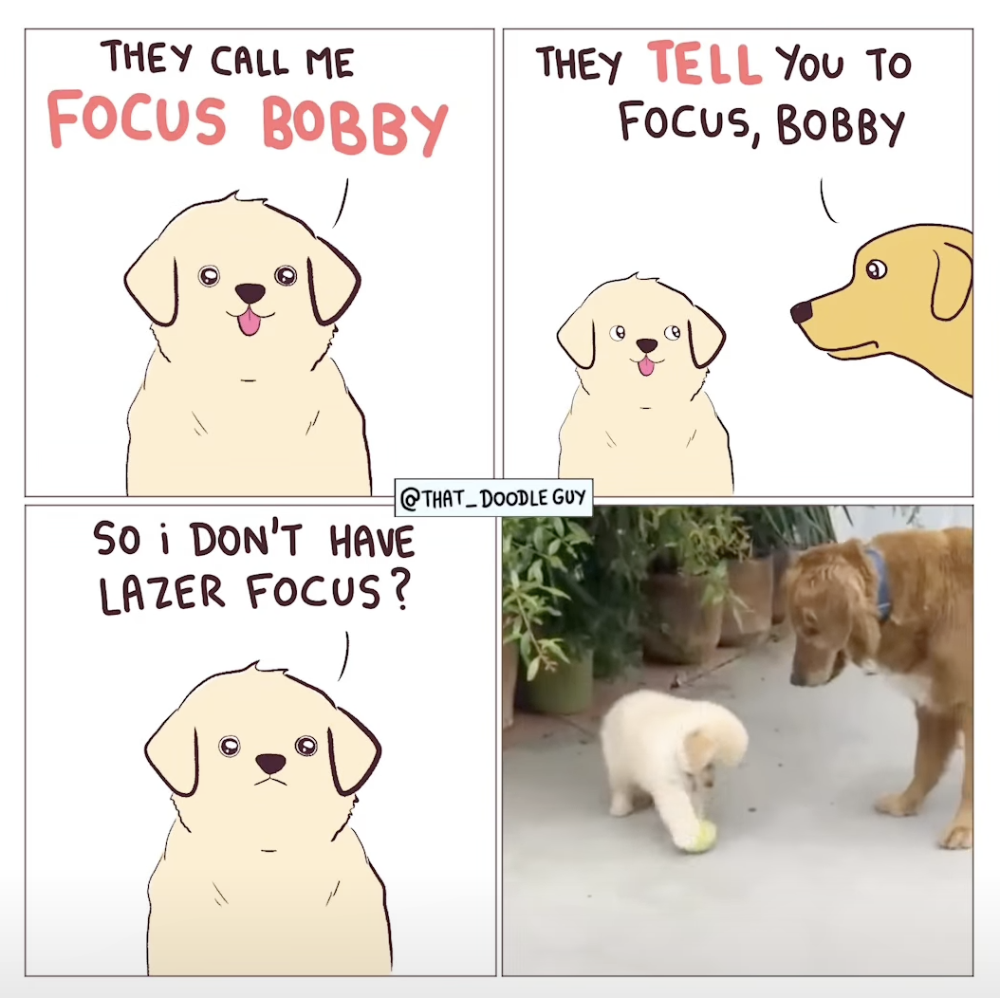

<p align="center"></p>

# Bobby

**Bobby** turns a GitHub pull request into a short walk of focused pages. It finds the core changes and, around each one, the code they rely on and the code they affect and generates an easy to consume tree. You can zoom out to see the whole tree, or walk it page by page. Mark pages as you go, draft comments, and submit them to GitHub as one review. Your place and progress survive interruptions and force-pushes.

Install

```sh
curl -fsSL https://raw.githubusercontent.com/angrybayblade/bobby/main/install.sh | bash
```

## Quick start

```sh
bobby https://github.com/owner/repo/pull/123
bobby 123        # inside a clone of the repo
bobby            # no PR: review the branch you're on, uncommitted changes included (nothing to review: the home page)
bobby home       # or bobby outside a repo: pick a PR from your recents, review requests and your own
```

One Bobby holds every review you open: running `bobby <PR>` again adds it to the one already running.

You'll need `git`; the release binary carries everything else, and Bobby offers to install GitHub's CLI, `gh`, and sign you in the first time it runs. On a cloud VM, open it through an SSH tunnel, or with `--host 0.0.0.0 --allow-host <its name>` (see [on a remote machine](docs/getting-started.md#on-a-remote-machine)). With the `claude` CLI installed, Claude organises the PR into a smarter tree in the background, using your Claude Code login; Bobby offers to install it and sign you in the first time it runs.

In the UI: `j`/`k` to step, arrow keys to move up and down in the tree, `enter`/`esc` to zoom, `a` for looks good, `c` to comment, `N` for the next unresolved thread, `v` to switch view, `s` to submit, and `?` for every key. Reply to, resolve, edit and delete GitHub threads where they sit.

## Docs

- **User manual**: [getting started](docs/getting-started.md) · [reviewing a PR](docs/reviewing.md) · [views](docs/views.md) · [settings](docs/settings.md) · [what leaves your machine](docs/privacy.md)
- **Implementation**: [architecture](docs/architecture.md) · [extraction pipeline](docs/extraction.md) · [server and state](docs/server-and-state.md) · [browser runtime](docs/frontend.md) · [contributing](docs/contributing.md)
- **Format**: [review graph v1](SPEC.md), the open format between extraction and views

## License

MIT: see [LICENSE](LICENSE). Bobby's binaries include the Bun runtime, tree-sitter and highlight.js, under their own licenses: see [THIRD_PARTY_NOTICES.md](THIRD_PARTY_NOTICES.md). The comic below is @that_doodleguy's, not covered by Bobby's license.

---

<sub>Named after <a href="https://www.instagram.com/reels/DHvczp9ScvD/">this comic</a> by <a href="https://www.instagram.com/that_doodleguy/">@that_doodleguy</a> on Instagram.</sub>

[](https://www.instagram.com/reels/DHvczp9ScvD/)
